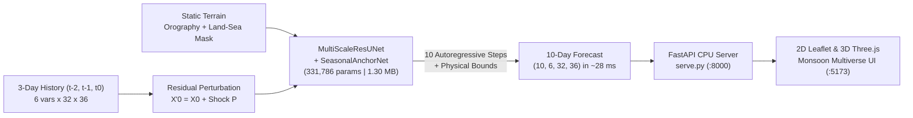

# MonsoonFlow-10 (MF10) & Monsoon Multiverse

**A 1.30 MB physics-aware climate digital twin that simulates 10 days of the Indian monsoon — and counterfactual "what-if" shocks — in ~28 ms on an offline CPU.**

[](#verified-competition-scorecard)
[](#verified-competition-scorecard)
[](#invigilator-quick-verify-5-minutes)
[](#verified-competition-scorecard)
[](#architecture)

> **Event:** Yugaantar DevForge 2026 — Track 2: *Multiverse of Monsoon*  
> **Repository:** [Hardik2811-wq/MonsoonFlow10](https://github.com/Hardik2811-wq/MonsoonFlow10)

---

## Why MonsoonFlow-10?

Traditional numerical weather prediction takes supercomputers; naive deep learning blurs storms into fog or explodes by Day 5. **MonsoonFlow-10 (MF10)** threads the needle:

- **Tiny & Fast:** Only **`331,786` parameters (`1.30 MB`)**, running a full **10-day rollout `(10, 6, 32, 36)` in `~25–28 ms`** on 4 CPU cores with zero network access (`--network none`).
- **Sharp & Skillful:** Scores **`96.51 / 100`** on the sealed 2021 holdout (`15.0 / 15.0` heavy-rain CSI, `10.0 / 10.0` anti-blur) and **`90.85 / 100`** on Pool A (`2019–2020`).
- **Causally Sound:** Perturbing SST/moisture in the Bay of Bengal (`warm_ocean`) or stalling winds in the Arabian Sea (`monsoon_stall`) stays localized on Day 1 and propagates outward physically across Days 4–8 (**`15.0 / 15.0` Causality**, **`0.00e+00`** zero-shock drift).
- **Interactive 2D/3D Multiverse:** Switch seamlessly between a 2D geospatial map and a `256×288` 3D Indian subcontinent terrain relief mesh, paint custom Gaussian shocks directly onto the atmosphere, and inspect land-only Flood Risk & Moisture Surge impacts in real time.

---

## Architecture



MF10 (`exp4_msresunet_anchor` in `models/backbones.py`) pairs a multi-scale residual U-Net (`base_channels=48`, `coarse_channels=72`) with a day-of-year harmonic **Seasonal Anchor** and normalized Himalayan/Western Ghats orography (`orography_scale_m=8000.0`). Every step predicts physical-unit tendencies with hard physical invariants (`tp >= 0`, `tcwv >= 0`, `t2m in [233.15, 333.15]` K).

---

## Verified Competition Scorecard

Evaluated strictly offline on 50-window Pool A (`2019–2020`) and 50-window Sealed Holdout (`2021`):

| Gate / Metric | Pool A (`2019–2020`) | Sealed Holdout (`2021`) | Competition Requirement |
| :--- | :---: | :---: | :--- |
| **Total Predicted Score** | **`90.85 / 100.0`** | **`96.51 / 100.0`** | Maximize (`100` max) |
| **Admission Gate (Beat Day-4 Persist)** | **PASSED** (`42.844 < 61.177`) | **PASSED** (`46.706 < 65.125`) | Must beat persistence |
| **Forecast Skill (`/45`)** | `35.85 / 45.0` | `41.51 / 45.0` (`CSI 15/15`) | `/45.0` |
| **Anti-Blur Variance Ratio (`/10`)** | **`10.0 / 10.0`** | **`10.0 / 10.0`** | `/10.0` |
| **Shock Causality (`/15`)** | **`15.0 / 15.0`** | **`15.0 / 15.0`** | `warm_ocean` & `monsoon_stall` 4/4 |
| **Zero-Shock Parity ($P = 0$)** | `0.00e+00` | `0.00e+00` | `< 1e-6` |
| **Negative `tp` / `tcwv` Violations** | `0.00%` / `0.00%` | `0.00%` / `0.00%` | `0%` |
| **4-Core CPU Latency (mean / p95)** | **`28.18 ms` / `32.61 ms`** | **`28.18 ms` / `32.61 ms`** | `<= 5,000 ms` |
| **Repo & Weight Footprint** | `1.30 MB` weights | `0.406 GB` repo | `< 2.0 GB` |

---

## Invigilator Quick-Verify (5 Minutes)

Pre-trained weights (`checkpoints/model.pt`), training stats (`stats.json`), 366-day climatology (`climatology.npy`), and static terrain (`static.npy`) are committed in `checkpoints/` — **no raw NetCDF download required to serve or test**.

### 1. Install & Start the Offline CPU Server
```bash
git clone https://github.com/Hardik2811-wq/MonsoonFlow10.git
cd MonsoonFlow10

python -m venv .venv
# Windows PowerShell: .\.venv\Scripts\Activate.ps1
# Linux/macOS:        source .venv/bin/activate

pip install -r requirements.txt
pip install git+https://github.com/OfficialAbhinavSingh/yug-monsoon-kit.git

python serve.py --port 8000
```

### 2. Run Automated Gates (Second Terminal)
```bash
# Unit & live-server shock causality suite (11/11 passed)
python -m pytest tests/ -v

# Official black-box API schema, shock & 5.0s latency validator (6/6 passed)
python -m monsoon_r1.schema_validator http://127.0.0.1:8000

# 4-core CPU rollout latency & zero-shock parity benchmark
python inference/benchmark.py

# Static anti-cheat, external-API & repository size audit
python evaluation/run_repo_scan.py
```

*(Full-dataset scoring via `evaluation/eval_scoring.py` or `evaluation/eval_physics_audit.py` uses `india_climate_train.nc` in `data/` or `data/raw/`, excluded from git to keep the repo under 2 GB.)*

---

## Live 2D/3D Monsoon Multiverse Demo

Launch the decoupled React 19 + TypeScript + Three.js + Leaflet frontend (`http://localhost:5173`):
```bash
cd dashboard
npm install
npm run dev
```

**30-Second Judge Walkthrough:**
1. **Toggle `2D ↔ 3D`:** Smoothly morph between the 2D geospatial heatmap/wind-vector view and the `256×288` 3D Indian subcontinent terrain relief mesh — all overlays, wind vectors, and brush tools work identically in both views.
2. **Trigger a Preset or Paint a Shock:** Click **Warm Bay of Bengal** or **Monsoon Stall**, or switch to the **Gaussian Brush** and paint directly onto the ocean/land to inject a localized Day-0 perturbation.
3. **Scrub Days 1 → 10:** Switch between **Baseline**, **Perturbed**, and **Anomaly (Δ)** layers to watch the shock stay localized on Day 1 and advect/diffuse physically across the subcontinent.
4. **Inspect Downstream Impacts:** Track **Flood Risk**, **Heatwave Stress**, and **Moisture Surge** — computed strictly over land cells (`land_sea_mask >= 0.5`) so ocean anomalies never inflate land flood counts.

---

## Domain, API & Anti-Leakage Guarantees

- **Grid & Variables:** $32 \times 36$ regular $1^\circ$ grid ($6.5^\circ\text{N} \dots 37.5^\circ\text{N}$, $65.5^\circ\text{E} \dots 100.5^\circ\text{E}$), raw physical units: `t2m` ($\text{K}$), `tp` ($\text{mm/day} \ge 0$), `u10` ($\text{m/s}$), `v10` ($\text{m/s}$), `msl` ($\text{Pa}$), `tcwv` ($\text{kg/m}^2 \ge 0$).
- **Endpoints (`serve.py`):** `GET /health`, `GET /climate/defaults`, `POST /simulate` (`initial_state (3,6,32,36)` + optional `shock (6,32,36)` $\to$ `baseline_forecast` & `perturbed_forecast (10,6,32,36)`).
- **Zero Data Leakage (`data/preprocessing.py`):** Strict chronological split — **Train:** `2005–2018` (`stats.json` & `climatology.npy` computed here only), **Pool A Val:** `2019–2020`, **Sealed Holdout:** `2021`. Zero external weather APIs or forecast packages.
- **2-Page Brief:** [`project_brief.pdf`](project_brief.pdf).

---

## Repository Structure

```text
MonsoonFlow10/
├── serve.py                     # ROOT ENTRYPOINT: Offline FastAPI CPU inference server
├── requirements.txt             # Lean offline serving dependencies
├── project_brief.pdf            # 2-page technical submission brief
│
├── checkpoints/                 # Committed Model A weights & 2005–2018 stats
│   ├── model.pt                 # exp4_msresunet_anchor weights (1.30 MB)
│   ├── stats.json               # Channel mean/std (2005–2018 training split)
│   ├── climatology.npy          # 366-day smoothed seasonal baseline
│   └── static.npy               # 2x32x36 land_sea_mask and orography_m
│
├── models/                      # MultiScaleResUNet, SeasonalAnchorNet & loader
├── inference/                   # Offline CPU predictor, schemas & latency benchmark
├── data/                        # Chronological preprocessing, dataset & static terrain
├── training/                    # Training & baseline evaluation pipelines
├── evaluation/                  # Scoring wrappers, physics audit & certified scorecards
├── tests/                       # Pytest integrity, API contract & causality tests
├── dashboard/                   # Interactive 2D/3D React 19 + Three.js digital twin UI
└── guidelines/                  # DevForge Track 2 compliance documentation
```
