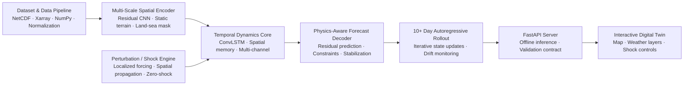
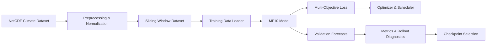
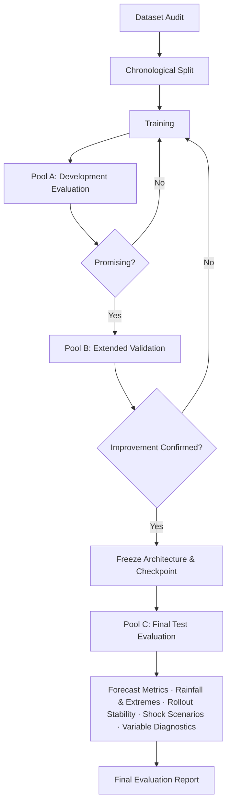

# Track 2: Multiverse of Monsoon — Recommended Deep Tech Stack & Architecture

> **Goal:** Build a compact, physics-aware spatiotemporal forecasting engine with a controllable simulation layer — not a weather dashboard with an ML model attached.
>
> **Official Round 1 Reference Kit:** [OfficialAbhinavSingh/yug-monsoon-kit](https://github.com/OfficialAbhinavSingh/yug-monsoon-kit) (cloned locally under `resources/yug-monsoon-kit/`).
> **Companion Research Roadmap:** [`monsoon-multiverse-research-roadmap.md`](./monsoon-multiverse-research-roadmap.md) (detailed literature review, dataset traps, benchmarks, and 6-part synthesis).

Based on the hackathon brief, the system must forecast **6 weather channels** on a **32 × 36 spatial grid**, roll forward **at least 10 days**, avoid drift and blur, react to localized shocks, beat baselines, and serve predictions through an **offline CPU API**.

The recommended design is a **hybrid spatiotemporal neural digital twin** (**MonsoonFlow-10 / MF10**).

---

## 1. High-Level Architecture: Yugaantar Climate Digital Twin



**Key design decision:** Do not use a giant transformer. Build a small, carefully engineered hybrid model that trains fast, rolls forward stably, and survives CPU-only inference.

---

## 2. Deep Tech Stack

### A. Data Engineering & Preprocessing

| Technology | Purpose | Priority |
| :--- | :--- | :--- |
| **Python** | Core language | Essential |
| **Xarray** | Reading, slicing, and manipulating NetCDF climate data | Essential |
| **NetCDF4** | NetCDF data backend | Essential |
| **NumPy** | Tensor preprocessing and numerical operations | Essential |
| **Pandas** | Metadata, statistics, and tabular utilities | Useful |
| **Scikit-learn** | Baselines, normalization utilities, and evaluation metrics | Essential |
| **Matplotlib** | Diagnostics and training plots | Essential |

#### Pipeline Responsibilities
1. Read the `india_climate_train.nc` dataset.
2. Extract the **6 dynamic channels**:
   - `t2m`: temperature
   - `tp`: precipitation
   - `u10`: east-west wind
   - `v10`: north-south wind
   - `msl`: mean sea-level pressure
   - `tcwv`: total column water vapour
3. Extract the **2 static channels**:
   - `land_sea_mask`
   - `orography_m`
4. Normalize channels using **training-only statistics**.
5. Construct sliding temporal windows.
6. Split train/validation data **chronologically** — never randomly split daily weather windows, as overlapping windows from nearby dates leak future information into validation.

### B. Core Deep Learning Stack

| Technology | Role |
| :--- | :--- |
| **PyTorch** | Neural model and training (primary framework) |
| **TorchScript** | Optional model optimization/export path, if compatible |
| **ONNX Runtime** | Optional CPU inference benchmarking |
| **SciPy** | Scientific utilities and numerical diagnostics |
| **NumPy** | Model data and numerical analysis |

> Use **PyTorch** as the primary framework. Do not simultaneously build competing implementations in JAX, TensorFlow, and PyTorch — the hackathon needs experimentation velocity and reliable deployment.

---

## 3. Neural Architecture Layer by Layer: MonsoonFlow-10 (MF10)

> *Note: MF10 is an original project architecture proposal, not a pretrained or benchmark-proven architecture.*

### Module 1: Spatial & Environmental Encoder
- **Architecture:** Multi-scale residual CNN
- **Input tensor:**

$$X \in \mathbb{R}^{B \times 3 \times 6 \times 32 \times 36}$$

Where $B$ = batch size, $3$ = previous 3 days, $6$ = weather variables, and $32 \times 36$ = spatial grid. Static channels (`land_sea_mask`, `orography_m`) can be concatenated with each daily input (8 channels/day) or injected via a separate conditioning branch.

```text
Input (8 channels/day: 6 weather + 2 static)
  └─▶ Conv2D (3×3, 32 features) — initial feature extraction
        └─▶ Residual Block × 2 (32 → 64 feature channels) — multi-scale spatial patterns
```

- **Suggested components:** `3×3` convolutions, residual connections, `GroupNorm` or `LayerNorm`, `GELU` or `SiLU` activation, multiple receptive fields via stacked convolutions.
- **Why residual CNN?** Weather is spatial (rainfall structures, temperature gradients, pressure patterns, wind fields). Avoid aggressively downsampling the $32 \times 36$ grid so localized rain and shock information are preserved.

### Module 2: Temporal Dynamics Core
- **Architecture:** ConvLSTM with residual feature processing
- The 3 preceding daily states are encoded and fed sequentially into the temporal core:

| Layer | Configuration |
| :--- | :--- |
| **Input** | Encoded spatial features |
| **ConvLSTM 1** | Hidden channels: `64` |
| **ConvLSTM 2** | Hidden channels: `64` |
| **Residual Feature Block** | `64` channels |
| **Temporal State** | Retained for next autoregressive step |

The ConvLSTM hidden state captures evolving rainfall across neighboring regions, wind field dynamics, pressure–wind interactions, and moisture transport. (Consider also testing alternative spatiotemporal backbones during experimentation.)

### Module 3: Multi-Channel Prediction Decoder
- **Architecture:** Residual CNN decoder

```text
Temporal Hidden State (64 channels)
  └─▶ Residual Conv Block (64 → 32)
        └─▶ Conv2D Prediction Head (32 → 6 channels)
              └─▶ Predicted Weather Delta (6 × 32 × 36)
```

- **Predict residuals by default:**

$$\hat{X}_{t+1} = X_t + \Delta X_t$$

Where $X_t$ is the latest weather state and $\Delta X_t$ is the predicted change. Residual forecasting models changes relative to the current state; compare against direct prediction on validation.

---

## 4. Shock Simulation Engine

The competition explicitly tests three perturbations:
1. **Warm Bay of Bengal**
2. **Weaker Arabian Sea wind**
3. **Zero shock**

### Perturbation-Conditioned Dynamics
The model accepts a perturbation tensor:

$$P \in \mathbb{R}^{6 \times 32 \times 36}$$

1. **Apply the perturbation:** Added as a physical delta to `init_states[-1]`:
   $$X'_t = X_t + P$$
   where $P$ is zero outside the perturbed region.
2. **Condition the model:** Feed the perturbed initial state into the dynamics pipeline so the system responds to localized spatial inputs.
3. **Propagate naturally:** Do **not** hardcode a propagation radius; let spatial convolutions and ConvLSTM memory evolve the shock across the grid.

### Zero-Shock Consistency Contract
When $P = 0$, the perturbed model must match the unperturbed baseline under deterministic inference:

```python
baseline = model(initial_state, perturbation=None)
zero_shock = model(
    initial_state,
    perturbation=torch.zeros_like(initial_state[:, -1]),
)
assert torch.allclose(baseline, zero_shock, atol=1e-6)
```

---

## 5. Physics-Aware Training Strategy

### Composite Loss Function

$$\mathcal{L} = \lambda_{\text{forecast}}\mathcal{L}_{\text{forecast}} + \lambda_{\text{rain}}\mathcal{L}_{\text{rain}} + \lambda_{\text{stability}}\mathcal{L}_{\text{stability}} + \lambda_{\text{physics}}\mathcal{L}_{\text{physics}}$$

1. **Forecast loss ($\mathcal{L}_{\text{forecast}}$):** $\operatorname{MSE}(\hat{X}, X)$ — also test MAE or MSE+MAE due to skewed precipitation distributions.
2. **Heavy-rain loss ($\mathcal{L}_{\text{rain}}$):** Weight rainfall pixels above a training-derived threshold; evaluate rain hit rates, false alarms, and missed heavy-rain events.
3. **Stability loss ($\mathcal{L}_{\text{stability}}$):** Penalize excessively large predicted increments and unstable rollout behavior while monitoring physical ranges, temporal variance, and spatial variance (without suppressing real extremes).
4. **Physics-inspired loss ($\mathcal{L}_{\text{physics}}$):** Lightweight constraints and diagnostics:
   - Penalize negative precipitation (`tp < 0`).
   - Penalize implausible abrupt changes across channels.
   - Use wind/pressure spatial patterns and total moisture behavior as diagnostic signals.
   - *Caution:* Do **not** blindly enforce strict mass/energy conservation on a regional grid — weather over India exchanges mass and energy across boundaries.

---

## 6. Training Pipeline & Experiment Stack

### Recommended Tools
- **Training:** PyTorch
- **Tracking:** TensorBoard (and/or Weights & Biases)
- **Visualizations:** Matplotlib
- **Baselines & Metrics:** Scikit-learn, NumPy, Xarray

### Pipeline Flow



### Starting Hyperparameters

| Parameter | Starting Experiment |
| :--- | :--- |
| **Model** | MF10 |
| **Input sequence** | 3 days |
| **Prediction** | 1 day per forward pass |
| **Rollout** | 10 days autoregressively |
| **Hidden channels** | 64 |
| **Batch size** | 8 or 16 (compute-dependent) |
| **Optimizer** | AdamW |
| **Learning rate** | $1 \times 10^{-3}$, then tune |
| **Weight decay** | $1 \times 10^{-4}$, then tune |
| **Scheduler** | Cosine decay or `ReduceLROnPlateau` |
| **Loss** | Weighted multi-objective |
| **Training / Inference** | GPU if available / CPU for final inference |

### Autoregressive Rollout Curriculum
1. **Phase 1:** Train 1-day prediction (learn spatial & temporal mapping).
2. **Phase 2:** Train 3-day autoregressive rollout (cope with own prediction errors).
3. **Phase 3:** Train 5-day rollout (improve stability and temporal consistency).
4. **Phase 4:** Train/fine-tune with 10-day rollout loss (target competition horizon).

---

## 7. Backend & Offline CPU Inference Stack

| Technology | Purpose |
| :--- | :--- |
| **FastAPI** | HTTP inference server |
| **Uvicorn** | ASGI server for FastAPI |
| **Pydantic** | Request/response validation |
| **PyTorch** | Load and execute model |
| **NumPy** | Data conversion |
| **ONNX Runtime** | Optional CPU performance experiment |

### Required API Contract
- `POST /health` — Check if model is ready.
- `POST /simulate` — Receive initial weather states, day-of-year `sin`/`cos` values, requested simulation steps, and optional perturbation; run the model; return the 10-step rollout and inference time.

Keep the server minimal and reliable — it runs offline under strict CPU and RAM constraints.

---

## 8. Frontend: Digital Twin Dashboard

### Recommended Stack
- **React + TypeScript + Vite + Tailwind CSS**
- **Leaflet / React Leaflet** (geographic map layers)
- **Recharts** (diagnostics and time-series charts)

### Five Core Dashboard Modules
1. **India Climate Map:** Temperature, rainfall, wind vectors, pressure, water vapour, and orography overlay.
2. **Forecast Timeline:** Interactive scrubber from Day 0 through Day 10.
3. **Multiverse / Shock Lab (Standout Feature):** Select region, weather variable, and shock intensity; run simulation; compare Baseline vs. Alternate (e.g., Warm Bay of Bengal).
4. **Forecast Diagnostics:** RMSE, MAE, heavy rainfall hit rate, day-wise error, spatial error maps, and rollout stability.
5. **Impact Module:** Monsoon impact explorer mapping rainfall anomaly → flood risk indicators → crop stress indicators (derived from actual model output, with clear limitations stated).

---

## 9. Recommended Repository Structure

```text
monsoonflow/
├── data/
│   ├── preprocessing.py
│   ├── dataset.py
│   └── statistics.py
├── models/
│   ├── encoder.py
│   ├── convlstm.py
│   ├── decoder.py
│   ├── physics_losses.py
│   ├── shock_engine.py
│   └── mf10.py
├── training/
│   ├── train.py
│   ├── validate.py
│   ├── rollout.py
│   └── metrics.py
├── inference/
│   ├── predict.py
│   └── model_loader.py
├── server/
│   ├── serve.py
│   └── api.py
├── dashboard/
│   ├── src/
│   └── ...
├── checkpoints/
│   └── model.pt
├── tests/
│   ├── test_api.py
│   ├── test_shocks.py
│   └── test_rollout.py
├── README.md
├── requirements.txt
└── project_brief.pdf
```

---

## 10. Competition Scoring Priorities (PDF Page 10)

| Priority | Focus Area | Points |
| :--- | :--- | :---: |
| **1** | Forecast skill, including heavy rain | **45** |
| **2** | Stable dynamics and shock behavior | **25** |
| **3** | Repository correctness and real training | **15** |
| **4** | Project brief | **15** |

### Execution Checklist
- **Priority 1 (Forecast Skill):** Beat repeat-yesterday and climatology; improve Day 1, 4, and 8 quality; focus on heavy rain; validate across multiple weather windows.
- **Priority 2 (Dynamics):** Stable 10-day rollout, no NaNs/Infs, nonnegative rainfall, no blurry-average collapse, localized shocks with sensible propagation.
- **Priority 3 (Repository):** Correct offline inference, weights included, real training code, no hardcoded dates, no external weather APIs, no lookup tricks.
- **Priority 4 (Brief):** Clearly document architecture, training approach, physics-awareness, drift prevention, failure modes, dashboard, and impact extension.

---

## 11. Final Summary & Build Order

| Layer | Stack |
| :--- | :--- |
| **Data** | Python, Xarray, NetCDF4, NumPy, Pandas |
| **Deep Learning** | PyTorch |
| **Architecture** | Multi-scale Residual CNN + ConvLSTM + Residual Decoder |
| **Physics-Aware Layer** | Residual state prediction, stability diagnostics, channel constraints |
| **Shock Engine** | Spatial perturbation injection + autoregressive propagation |
| **Training** | AdamW, rollout curriculum, multi-objective loss |
| **Tracking** | TensorBoard, Matplotlib |
| **Backend** | FastAPI, Uvicorn, Pydantic |
| **Frontend** | React, TypeScript, Vite, Tailwind, Leaflet, React Leaflet, Recharts |
| **Deployment** | Offline CPU inference, optimized PyTorch, optional ONNX benchmark |

**Recommended build order:**
`baseline → spatial model → ConvLSTM → autoregressive rollout → shock conditioning → stability & rain loss → validation → API → dashboard → impact module`

---

## 12. Official Round 1 Reference Kit Analysis (`yug-monsoon-kit`)

**Reference Repository:** <https://github.com/OfficialAbhinavSingh/yug-monsoon-kit>  
**Local Path:** `resources/yug-monsoon-kit/` (`monsoon-r1-kit` v1.0.0, MIT License)

The `yug-monsoon-kit` package defines the **exact automated judge contract, scoring math, static anti-cheat scanner, dataset builder, and starter server** for Round 1. Every engineering decision in MF10 must satisfy these exact constraints.

### 12.1 Kit Module Map (`monsoon_r1/`)

| File | Responsibility |
| :--- | :--- |
| `docs/R1_CONTRACT.md` | Authoritative Round 1 API addendum, wire format, units, container limits, and blind test specification |
| `monsoon_r1/contract.py` | Frozen constants (`LAT`, `LON`, `CHANNELS`, `T_IN=3`, `SCORE_STEPS=10`, `MAX_STEPS=14`, `TIME_LIMIT_S=5.0`, `LEAD_DAYS=(1,4,8)`), `box_mask()`, `lat_weights()`, `encode_list()`, `encode_array()`, `decode_array()`, `doy_sincos()` |
| `monsoon_r1/scoring.py` | Pure-NumPy grader: `rmse_lat()`, `skill_vs_best_ref()`, `csi()`, `validity()`, `variance_ratio()`, `anti_blur_points()`, `causality_checks()`, `causality_points()`, `null_consistent()`, `make_shock()` |
| `monsoon_r1/repo_scan.py` | Static AST/regex/binary scanner (`scan()`) worth **15 points** (8 anti-cheat + 7 code health) |
| `monsoon_r1/schema_validator.py` | Pre-submission black-box HTTP validator checking `/health`, `/simulate` in both JSON list and base64 formats, shocks, null consistency, and the 5.0 s limit |
| `monsoon_r1/stats.py` | Computes `stats.json` (per-channel `mean`, `std`) and 15-day circularly smoothed 366-day `climatology.npy` (`[366, 6, 32, 36]`) |
| `monsoon_r1/build_dataset.py` | Training archive builder & dataset preparation utilities |
| `monsoon_r1/client.py` | HTTP client helpers (`wait_ready()`, `call_simulate()`) used by the validator and grader |
| `monsoon_r1/template/serve.py` | Minimal FastAPI + Uvicorn starter server (persistence placeholder) |

### 12.2 Exact Grid, Wire Format & Server Contract

- **Spatial Grid:** `32 × 36` cells at `1° × 1°` resolution:
  - Latitude centers: `6.5° .. 37.5°` (south → north, `NLAT = 32`)
  - Longitude centers: `65.5° .. 100.5°` (west → east, `NLON = 36`)
  - Each cell is the mean of the 4 surrounding `1°` ERA5 points.
- **Channel Order & Daily Aggregation (Physical Units on the Wire — NEVER Normalized):**
  - `0: t2m` (K) — mean of 00, 06, 12, 18 UTC
  - `1: tp` (mm/day) — 24 h sum
  - `2: u10` (m/s) — mean of 00, 06, 12, 18 UTC
  - `3: v10` (m/s) — mean of 00, 06, 12, 18 UTC
  - `4: msl` (Pa) — mean of 00, 06, 12, 18 UTC
  - `5: tcwv` (kg/m²) — mean of 00, 06, 12, 18 UTC
- **Static Fields (`2 × 32 × 36`):** `land_sea_mask` and `orography_m` ship inside `india_climate_train.nc` (variable `static`), **not** in `/simulate` requests — bundle them in the repo alongside `stats.json`.
- **Normalization Boundary:** Normalize on input inside `simulate()` using `stats.json` (`mean`, `std`), run MF10, and **de-normalize back to physical units** before returning.
- **Day-of-Year Convention:** `doy_sincos = [sin(2π·doy/365), cos(2π·doy/365)]` corresponds to the **last input day** (`init_states[-1]`), so forecast step `k` (0-indexed) is `doy + (k + 1)`.
- **Endpoints & Canonical Wire Format:**
  - `POST /health` → `200 {"status": "ready", "model_name": "..."}` (judge polls every 2 s up to 120 s; load weights at import time, not inside `/simulate`).
  - `POST /simulate` → accepts `{"init_states": [3,6,32,36], "doy_sincos": [sin, cos], "steps": 10, "perturbation": null | [6,32,36]}` and returns `{"rollout": [steps,6,32,36], "inference_ms": float}`.
  - Canonical format is **plain nested JSON lists of finite floats** (`NaN`/`Inf` fail the validity gate).
- **Root `serve.py` Requirement:** Unlike `server/serve.py` in generic layouts, the organiser container executes **`python serve.py --port 8000`** from the **repository root**, listening on **`0.0.0.0`**.
- **Offline Container Limits:**
  - `--network none` (no internet — no Hugging Face downloads, no external APIs)
  - **6 GB RAM, 4 CPU cores, no GPU**
  - **5.0 s hard wall-time limit** per `/simulate` call (10 steps, response `< 80 MB`, no retries)
  - **Pre-installed libraries in judge container:** `torch` (CPU), `numpy`, `scipy`, `pandas`, `xarray`, `scikit-learn`, `lightgbm`, `onnxruntime`, `FastAPI`, `Flask`, `uvicorn`, `gunicorn`.

### 12.3 Exact Scoring Formulas & Thresholds (`scoring.py`)

The judge sends **8 blind calls** (5 real windows from dates after `2023-01-10`, plus 3 shock calls on one window):

1. **Hard Gate for Round 2:**
   - Beat persistence at Day 4.
   - Pass physical validity on all 8 calls: exact shape `(steps, 6, 32, 36)`, all finite (`no NaN/Inf`), `tp >= -1e-6`, `t2m` in `[233.15, 333.15]` K (`[-40, +60] °C`).
   - Produce a non-zero, localized response to at least one shock.

2. **Forecast Skill (45 pts):**
   - **RMSE Skill (30 pts):** Latitude-weighted RMSE ($\cos(\text{lat})$ normalized) at lead days `(1, 4, 8)` across all 6 channels and 5 windows:
     $$\text{SS} = 1 - \frac{\text{RMSE}_{\text{model}}}{\min(\text{RMSE}_{\text{persist}}, \text{RMSE}_{\text{clim}})}$$
     Full 30 pts earned at mean skill `SS_REF = 0.12`.
   - **Heavy-Rain CSI (15 pts):** Critical Success Index at `RAIN_THRESH = 10.0 mm/day` on lead days `(1, 4, 8)`; full 15 pts earned at `CSI_SS_REF = 0.10` over the best reference.

3. **Dynamics & Multiverse Causality (25 pts):**
   - **Anti-Blur (10 pts):** At Day 8, per-channel spatial variance ratio $\text{Var}(\text{pred}) / \text{Var}(\text{true})$ must be $\ge 0.40$ (`BLUR_MIN_RATIO`) and $\le 2.5$ (`BLUR_MAX_RATIO`, preventing noise injection).
   - **Perturbation Causality (15 pts):** Tests 2 physical shocks + 1 null shock:
     - `warm_ocean`: Bay of Bengal `(8.0..20.0°N, 82.0..94.0°E)` → `+3.0 K` on `t2m`, `+15%` of current `tcwv`.
     - `monsoon_stall`: Arabian Sea `(8.0..20.0°N, 65.0..75.0°E)` → `-40%` of current `u10` and `v10`.
     - **Four hierarchical checks per shock** (a non-localized response caps at 1/4 credit; no response scores 0):
       1. `nonzero`: $\max |\Delta / \sigma| \ge 10^{-3}$ (`NONZERO_MIN`)
       2. `localized`: Day-1 squared standardized response energy within `DILATE = 3` grid cells of the shock box $\ge 60\%$ (`LOCAL_MIN_FRAC = 0.60`)
       3. `propagates`: Outside-neighborhood energy grows from Day 1 to Days 4–8 ($\text{late} > 1.5 \cdot \text{out}_0 + 10^{-12}$ and $> 0.02 \cdot \max \text{energy}$) **and no teleportation** (`< 5%` of energy beyond `DILATE + 8.0 * (k + 1)` cells on day `k+1`, i.e., `MAX_SPEED_CELLS_PER_DAY = 8.0`)
       4. `stable`: $\max |\Delta / \sigma| \le 5.0$ (`STABLE_MAX_STD`)
     - **Null shock (`perturbation = zeros`):** $\max |\Delta_{\text{null} - \text{base}} / \sigma| \le 10^{-3}$ (`NULL_TOL`). Failing this **halves** the causality score.

### 12.4 Static Repo Scanner & Anti-Cheat Rules (`repo_scan.py` — 15 pts)

`repo_scan.scan()` inspects `serve.py` and every transitively imported local `.py` module (plus repo data/weight files) without executing code:
- **Critical violations (lose all anti-cheat points):**
  - Any external weather/data import or URL in inference code (`open-meteo`, `openweathermap`, `cdsapi`, `imdlib`, `weatherbench2`, `arco-era5`, `nomads.ncep`, `mausam.imd`, etc.).
  - `>= 5` hardcoded date literals (`YYYY-MM-DD`) in inference code (`>= 3` or `date()/datetime()/Timestamp()` triggers a warning).
  - Multi-year daily `.npy`/`.npz` archives with `shape[0] > 400` and trailing dims `(32, 36)` (a 1-year `366`-day `climatology.npy` is explicitly permitted).
  - Missing `/simulate` route or missing model checkpoint (`> 1 KB` weight file such as `.pt`, `.pth`, `.onnx`, `.safetensors`, or a local weight file since Hugging Face links fail offline).
- **Warnings (partial deduction + manual review):**
  - Shipping raw climate data files (`.nc`, `.nc4`, `.grib`, `.grib2`, `.zarr`) inside the submission repo — **do not commit `india_climate_train.nc`**.

### 12.5 Local Self-Test Commands

Run these before every submission:

```bash
# 1. Start the offline server from repo root
python serve.py --port 8000

# 2. Validate API contract, both wire formats, shocks, null consistency, and 5s limit
python -m monsoon_r1.schema_validator http://localhost:8000

# 3. Run the exact judge static repo scan
python -c "from monsoon_r1.repo_scan import scan; import json; print(json.dumps(scan('.'), indent=1))"
```

---

## 13. Competitive Landscape, Verified Pain Points & Strategic Differentiation

> **Core Risk:** Building a generic forecasting dashboard that already exists and calling the UI a breakthrough.
> **Core Opportunity:** Track 2 is uniquely defined by the combination of **regional Indian monsoon dynamics**, **user-controlled localized shocks**, **10-day autoregressive rollout stability**, **small-grid CPU constraints**, and **verifiable evaluation**.

### 13.1 Problem Taxonomy (Why Track 2 Is Distinct)

| Problem Type | Definition |
| :--- | :--- |
| **Forecasting** | Predict what weather will happen. |
| **Nowcasting** | Predict what weather will happen in the next minutes to hours. |
| **Downscaling** | Convert coarse forecasts into localized, higher-resolution outputs. |
| **Probabilistic Forecasting** | Generate multiple plausible futures (ensembles) rather than one. |
| **Weather Simulation** | Evolve an atmospheric state forward in time. |
| **Perturbation-Based Simulation** | Alter an initial condition or forcing ($X_0 + P$) and inspect how the simulated weather diverges. |

### 13.2 Existing Systems Landscape

#### A. Global AI Weather Foundation Models

| System | Organization | Core Approach | Strengths | Limitations Relative to Track 2 |
| :--- | :--- | :--- | :--- | :--- |
| **GraphCast** | Google DeepMind | Multi-scale mesh GNN, 0.25° grid, 6 h autoregressive steps (10 days) | Fast ML inference, multi-scale spatial reasoning | Deterministic; extreme rainfall underestimated; not optimized for Indian monsoon; no arbitrary user-controlled shock lab |
| **GenCast** | Google DeepMind | Generative/probabilistic ensemble forecasting | Captures uncertainty and multiple plausible trajectories (e.g., cyclone tracks) | Computationally heavy; not a user-created local shock sandbox |
| **Pangu-Weather** | Huawei | 3D Earth-specific Transformer with lead-time models | Models vertical + spatial atmospheric structure | Heavy training/data requirements; not designed for arbitrary regional shocks |
| **FourCastNet** | NVIDIA | Adaptive Fourier Neural Operator (spectral space) | High efficiency on large spatial grids | Spectral representations can smooth localized extremes; autoregressive drift; not a shock lab |
| **Aurora** | Microsoft | 1.3B-param foundation model (3D Swin Transformer + Perceiver) | Broad transferability across heterogeneous Earth datasets | Massive model size; pretrained knowledge is not an editable causal intervention engine |
| **ECMWF AIFS** | ECMWF | Operational ML forecasting (deterministic & ensemble up to 15 days) | Operational quality, verification, and initialization infrastructure | Institutional complexity; not an interactive arbitrary shock simulator |
| **WeatherNext 3** | Google DeepMind / Research | High-res hourly global forecasts integrating satellite + station observations | Observation-driven freshness and fine detail | Requires massive observation infra; not a standalone regional shock engine |

#### B. Consumer & Enterprise Weather Platforms
- **Windy.com / Windy.app:** Best-in-class map UX and multi-model comparison (ECMWF, GFS, ICON), but **consumes existing forecasts** rather than letting users perturb initial conditions and inspect causal evolution. Great UX reference; do not compete on maps alone.
- **Tomorrow.io:** Combines observations, ML, and operational risk/alert workflows for businesses, not an open scientific perturbation playground.
- **Meteoblue:** Multi-model meteograms and ensemble uncertainty products for interpretation, not user-driven shock interventions.

#### C. India-Specific Forecasting Initiatives
- **IMD AI-Enabled Monsoon & Hyperlocal Systems:** Operational 10-day localized forecasts across 16 states / 3,000+ sub-districts (and 1 km UP rainfall), focused on public weather services rather than a user-facing counterfactual shock simulator.
- **NCMRWF:** Integrates Pangu-Weather, GraphCast, FourCastNet, and GenCast with HPC downscaling and hybrid workflows at institutional scale — not a lightweight, CPU-accessible student shock laboratory.
- **Mausam (IMD):** Public forecast and warning dissemination app, not a programmable intervention model.

#### D. Scientific Benchmarks & Traditional NWP
- **WeatherBench 2:** Open evaluation framework, metrics, and baselines for scientific comparability — a benchmark, not a model or shock simulator.
- **ECMWF IFS (Traditional NWP):** Solves physical equations with data assimilation and coupled Earth components, but is computationally expensive and still challenged at fine convective scales.

### 13.3 Verified Pain Points & Track 2 Opportunities

1. **Extreme Rainfall Underprediction:** A 2026 observation-focused assessment of seven AI weather models during the South Asian monsoon (*MAUSAM*, 2026) found systematic underprediction of extreme precipitation, divergent cyclone tracks, and disagreements in mesoscale kinetic energy spectra. **Opportunity:** Optimize and evaluate explicitly on heavy-rain events (`>= 10 mm/day` CSI), not just mean RMSE.
2. **Mesoscale Fidelity Loss:** Models often blur sub-synoptic rainfall bands, sharp gradients, and localized wind structures. **Opportunity:** Preserve the `32 × 36` spatial resolution without aggressive downsampling and enforce anti-blur variance ratios (`0.40..2.5×`).
3. **Autoregressive Rollout Drift:** Feeding predictions back over 10 days amplifies errors. **Opportunity:** Curriculum rollout training (1 → 3 → 5 → 10 days) and stability monitoring.
4. **Uncertainty Blindness:** A single deterministic map looks falsely authoritative. **Opportunity:** Surface rollout diagnostics and divergence indicators transparently (without claiming calibrated probabilistic uncertainty unless actually calibrated).
5. **Regional vs. Global Performance:** Global benchmark scores do not guarantee South Asian monsoon skill. **Opportunity:** Focus strictly on Indian monsoon regimes and regional diagnostics.
6. **Controllable Weather Intervention (Key Differentiator):**

$$\text{Normal forecast: } X_0 \rightarrow X_1 \rightarrow X_2 \rightarrow \dots \rightarrow X_{10}$$

$$\text{Perturbed simulation: } X_0 + P \rightarrow X'_1 \rightarrow X'_2 \rightarrow \dots \rightarrow X'_{10}$$

*Scientific honesty note:* A learned model simulating an input perturbation $P$ does **not** prove real-world causal atmospheric effects — validate shock realism and regime boundaries explicitly.

### 13.4 Research & Product Gaps Matrix

| Gap | Current Reality | Track 2 Opportunity |
| :--- | :--- | :--- |
| **Controlled regional perturbation** | Public tools are prediction-only | Interactive shock intervention interface |
| **Monsoon intervention evaluation** | Benchmarks score forecasts, not shocks | Monsoon-focused shock validation protocol |
| **Long-horizon shock propagation** | Unperturbed rollouts dominate | Validate altered-state rollouts over 10 days |
| **Localized shock vs. global response** | Hard to inspect spatial spread | Visualize Day 1 → Day 10 response propagation |
| **Counterfactual comparison** | Apps compare models, not initial states | Side-by-side baseline vs. shock anomaly ($\Delta X_t$) |
| **Small, CPU-accessible simulation** | Global models need GPU clusters | Compact MF10 running `< 5 s` on 4 CPU cores |
| **Heavy rainfall under intervention** | Extremes are smoothed out | Prioritize heavy-rain CSI and anomaly maps |
| **Transparent model failure** | UIs hide instability | Rollout stability & shock-realism warnings |

### 13.5 Product Thesis: **Monsoon Multiverse** (6 Differentiating Features)

Rather than building a mini GraphCast, position the project as **Monsoon Multiverse: a compact, regional, shock-responsive weather simulation laboratory**:

1. **Baseline vs. Altered Reality ($\Delta X_t = X_t^{\text{shock}} - X_t^{\text{baseline}}$):** Run normal and perturbed states side by side and visualize the spatial anomaly across every day.
2. **Shock Propagation Explorer:** Track evolution across Day 0 (intervention) → Day 1 (localized response) → Day 3 → Day 5 → Day 10 (spatial extent, intensity, persistence/decay).
3. **Shock Realism Validator:** Warn the user before/during simulation if $P$ is out-of-distribution, spatially discontinuous, or violates physical bounds.
4. **Extreme Rainfall Analysis:** Heavy-rain hit/miss maps, rainfall anomaly maps, and `>= 10 mm/day` event comparison between baseline and shock runs.
5. **Rollout Stability Dashboard:** Expose lead-time error, spatial variance ratio, channel-wise error, and increment magnitudes instead of hiding drift.
6. **Multiverse Comparison:** Compare multiple simultaneous experiments (Baseline, Warm Bay of Bengal, Weaker Arabian Sea Wind, Custom Shock).

### 13.6 Pre-Coding Reading List (Recommended Order)

1. **GraphCast:** Autoregressive forecasting and multi-scale spatial representation — [DeepMind Research](https://deepmind.google/research/publications/22598/)
2. **GenCast:** Ensemble forecasting and uncertainty representation — [DeepMind Research](https://deepmind.google/research/publications/68149/)
3. **WeatherBench 2:** Evaluation methodology, metrics, and baselines — [WeatherBench 2](https://sites.research.google/gr/weatherbench/)
4. **Windy.com:** Spatial visualization and model comparison UX — [Windy.com](https://www.windy.com/)
5. **ECMWF AIFS:** Operational AI forecasting architecture — [ECMWF AIFS Docs](https://www.ecmwf.int/en/forecasts/datasets/aifs-machine-learning-data)
6. **South Asian Monsoon Assessment (2026):** AI model failure modes during Indian monsoon — [DOI: 10.1029/2025MS005568](https://doi.org/10.1029/2025MS005568)

### 13.7 Guardrails: What NOT to Build

- **Do not** build just a weather dashboard (Windy already does that).
- **Do not** build a chatbot over weather data (not the technical challenge).
- **Do not** claim "physics-aware" solely from a CNN + penalty — demonstrate measurable constraints and validated behavior.
- **Do not** claim real-world causal proof from a neural shock rollout.
- **Do not** chase higher spatial resolution or GraphCast-scale architectures — win the Track 2 benchmark on **validated shock propagation, baseline-vs-alternate comparison, extreme-rainfall skill, and 10-day rollout stability**.

---

## 14. Research-Backed Engineering Blueprint (Detailed Synthesis from Research Roadmap)

This section translates all technical findings from [`monsoon-multiverse-research-roadmap.md`](./monsoon-multiverse-research-roadmap.md) (global AI models, foundational backbones, dataset traps, WeatherBench 2 / heavy-rain evaluation, South Asian monsoon physics, and perturbation science) into concrete engineering choices for **MF10** and **Monsoon Multiverse**.

### 14.1 Architectural Insights from Global Models & Building Blocks

| Research Source | Core Mechanism | Why It Matters on Our `32 × 36` Regional Grid | Concrete MF10 Design Action |
| :--- | :--- | :--- | :--- |
| **GraphCast** (*Science* 2023) | Encoder–Processor–Decoder GNN on icosahedral multi-mesh; 2-step input; residual prediction; 1→12 step rollout curriculum; area/level/inverse-variance MSE | Polar grid convergence does **not** occur on India's `6.5..37.5°N, 65.5..100.5°E` box, so flat/regional 2D convs work cleanly without a spherical mesh. However, **MSE-induced blurring** at Days 5–10 and error compounding over rollouts apply directly. | Use residual prediction ($\hat{X}_{t+1} = X_t + \Delta X_t$), **latitude (`cos(lat)`) + channel-std loss weighting**, and a **multi-step rollout curriculum** (1 → 3 → 5 → 10 days). |
| **Pangu-Weather** (*Nature* 2023) | 3D Earth-Specific Transformer + hierarchical temporal aggregation (1h, 3h, 6h, 24h models) + weighted $L_1$ loss | Reducing recursive hops cuts drift, though pure direct multi-day jumps break step-by-step shock propagation. | Keep 1-day autoregressive steps for shock causality, and compare **weighted $L_1$ (MAE)** vs. MSE to sharpen extremes. |
| **FourCastNet / FNO / SFNO** | FFT spectral mixing ($O(N \log N)$) + **separate diagnostic head for precipitation** | Spectral mixing captures synoptic waves efficiently on CPU, while decoupling sparse/skewed `tp` prevents smooth wind/pressure MSE from washing out rain. | Consider a **decoupled precipitation prediction head** (`tp_head`) or an **FNO + Residual CNN/U-Net hybrid** if pure ConvLSTM smooths synoptic waves. |
| **ECMWF AIFS & GenCast** | Diffusion (`GenCast`) / **almost-fair CRPS** (`AIFS ENS`) | Plain deterministic MSE averages plausible storm tracks at Days 5–10, failing the Day-8 Anti-Blur check (`Var_pred / Var_true >= 0.40`). | If deterministic rollouts under-disperse (`ratio < 0.40`), add lightweight **noise-injected multi-sample CRPS training** or spectral/gradient-preserving regularization (much faster than iterative diffusion under the 5 s CPU budget). |
| **WeatherNext 2 (FGN)** | Single-pass Functional Generative Network ensemble (~8× faster than diffusion) | Demonstrates fast uncertainty/sharpness without iterative denoising loops. | Keep inference strictly **single-pass per rollout step** so 10 steps execute in milliseconds on 4 CPU cores. |
| **ResNet / U-Net / SimVP / PredRNN** | Skip connections, multi-scale U-Net, ST-LSTM (`PredRNN`), pure-CNN `IncepU` (`SimVP`) | On `32 × 36`, **Residual U-Net** (shallow 1–2 downsamples max) and **SimVP (`IncepU`)** are ultra-fast CPU baselines that preserve sharp Western Ghats / Himalayan orographic gradients. | Benchmark **Residual U-Net** and **SimVP** as fast ablation baselines alongside **MF10 (Residual CNN + ConvLSTM)**; avoid heavy PredRNN/ViT layers that blow up CPU latency. |

#### Mandatory Cyclic Temporal Conditioning (`doy_sincos`)
Monsoon dynamics shift dramatically across **onset (~June 1)**, **active/break MISO phases (10–20d / 30–60d)**, and **withdrawal (September–October)**.
- `R1_CONTRACT.md` passes `doy_sincos = [sin(2π·doy/365), cos(2π·doy/365)]` for `init_states[-1]`.
- **Implementation:** At 0-indexed forecast step $k \in \{0, \dots, \text{steps}-1\}$ (corresponding to $\text{doy} + k + 1$), rotate `[s_0, c_0]` by $\Delta\theta = \frac{2\pi (k + 1)}{365}$ without needing the raw `doy` integer:
  $$\begin{bmatrix} s_{k+1} \\ c_{k+1} \end{bmatrix} = \begin{bmatrix} \cos(\Delta\theta) & \sin(\Delta\theta) \\ -\sin(\Delta\theta) & \cos(\Delta\theta) \end{bmatrix} \begin{bmatrix} s_0 \\ c_0 \end{bmatrix}$$
- Broadcast `[s_{k+1}, c_{k+1}]` as 2 constant spatial planes (`2 × 32 × 36`) concatenated to the encoder input (making **10 input channels per step**: `6 dynamic + 2 static + 2 doy_sincos`) or injected via FiLM modulation.

---

### 14.2 Dataset Engineering & Real-Observation Validation Traps

Even though Round 1 training uses `india_climate_train.nc` (2005–2021 ERA5-derived daily fields) and judging runs offline on blind windows (`> 2023-01-10`), understanding upstream datasets prevents silent validation errors:

1. **The Reanalysis vs. Observation Gap (*MAUSAM*, [DOI: 10.1029/2025MS005568](https://doi.org/10.1029/2025MS005568)):**
   - Global AI models (GraphCast, Pangu, FourCastNet, GenCast, Aurora, AIFS) exhibit **15%–45% larger errors** when checked against real IMD gauges/stations/satellites than against ERA5 reanalysis.
   - ERA5 `total_precipitation` relies on convective parameterization and systematically **underpredicts extreme Indian monsoon rainfall**, **diverges on Bay of Bengal cyclone/depression tracks**, and **loses mesoscale kinetic energy**.
   - **Action:** During offline research/validation (outside `serve.py`), cross-check extreme-rain skill against **IMD $0.25^\circ$ Daily Gridded Rainfall** and **NASA GPM IMERG Final Run** whenever testing on 2005–2021 historical dates.

2. **Exact Dataset Trap Reference Table:**

| Dataset | Resolution / Coverage | Critical Gotcha / Trap | Correct Handling |
| :--- | :--- | :--- | :--- |
| **`india_climate_train.nc`** (Track 2) | `1° × 1°`, `32 × 36` (`6.5..37.5°N, 65.5..100.5°E`), 2005–2021 daily | `t2m, u10, v10, msl, tcwv` are 00/06/12/18 UTC means; `tp` is 24 h sum (`mm/day`); `static` (`2 × 32 × 36`) is inside `.nc` but **not** sent by `/simulate` | Bundle `static` (`land_sea_mask`, `orography_m`) + `stats.json` inside repo; **do not** ship `.nc` file in submission repo (`repo_scan.py` warns on `.nc`) |
| **Raw ERA5** | $0.25^\circ$, hourly (1940–present) | Raw `total_precipitation` is in **meters ($m$)**; reanalysis smooths cloudbursts | Multiply raw ERA5 `tp` by `1000` for `mm`; remember `msl` is `Pa` and `t2m` is `K` |
| **IMD $0.25^\circ$ Rainfall** (Pai et al., 2014) | $0.25^\circ$ India land (1901–2024, up to 6,955 gauges) | **Land-only** (`NaN` over ocean) AND **03:00 UTC (`08:30 IST`) accumulation trap** (June 15 = `June 14 03:00 UTC → June 15 03:00 UTC`) | Apply land mask before metrics; never compare `00:00–24:00 UTC` model sums directly to IMD without accounting for the 3 h offset |
| **NASA GPM IMERG (Final Run)** | $0.1^\circ$, 30-min, land + ocean | `precipitationCal` is a **rate (`mm/hr`)**, not a 30-min accumulation; Early/Late runs are not gauge-calibrated | Use **Final Run** for research validation; integrate/average rates and multiply by hours |
| **NOAA OISST v2.1** | $0.25^\circ$ daily SST (1981–present) | Ocean surface boundary driver (Bay of Bengal, Arabian Sea, IOD), not one of the 6 predicted API channels | Use offline to inform physically realistic SST/moisture shock magnitudes (`warm_ocean`) |

3. **Zero-Leakage Chronological Splitting:**
   - Weather is strongly autocorrelated across consecutive days. Split strictly by **calendar years** (e.g., Train: `2005–2018`, Val: `2019–2020`, Holdout Test: `2021`, plus matching post-2023 blind regime characteristics)—never random-shuffle `3`-day windows.

---

### 14.3 Heavy-Rainfall Loss Engineering & Anti-Blur Mechanics

#### Why Standard MSE Fails Both Skill & Dynamics
1. **Extreme Class Imbalance:** 80–90%+ of grid cells are dry or light drizzle; $<1\%$ hold heavy/extreme monsoon rain (`>= 10 mm/day` CSI threshold; IMD categories `>15.6`, `>64.5`, `>115.5 mm/day`).
2. **The Double-Penalty Problem:** Predicting a sharp storm 1 grid cell away incurs a **Miss** at the true cell and a **False Alarm** at the predicted cell—causing plain MSE models to hedge by predicting blurry drizzle everywhere.
3. **Direct Scoring Impact:** Blurring destroys both the **15-pt Heavy-Rain CSI** and the **10-pt Day-8 Anti-Blur check** (`Var_pred / Var_true` must stay in `[0.40, 2.50]`).

#### Concrete Loss Formulations to Implement in `physics_losses.py`
1. **Latitude- & Std-Weighted Forecast Loss ($\mathcal{L}_{\text{forecast}}$):**
   Match `scoring.py`'s `rmse_lat()` directly using normalized `cos(LAT)` weights $w_i$ and channel standard deviations $\sigma_c$ from `stats.json`:
   $$\mathcal{L}_{\text{forecast}} = \frac{1}{B \cdot C \cdot H \cdot W} \sum_{b,c,i,j} w_i \left(\frac{\hat{X}_{b,c,i,j} - X_{b,c,i,j}}{\sigma_c}\right)^2$$
   *(Also ablate Huber / Smooth-L1 or mixed L1+L2 to reduce over-smoothing.)*

2. **Skew-Aware & Intensity-Weighted Heavy-Rain Loss ($\mathcal{L}_{\text{rain}}$):**
   - Transform precipitation in an auxiliary loss branch via $\tilde{R} = \log(1 + R)$ (with $R = \max(\text{tp}, 0)$) so extreme spikes do not destabilize gradients.
   - Apply intensity weighting centered on the scoring threshold (`10.0 mm/day`) and heavy-rain tail:
     $$w_{\text{rain}}(R) = \min\big(1 + \alpha \cdot \mathbb{1}[R \ge 10.0] + \beta \cdot R,\; w_{\max}\big)$$
   - Optionally add a **differentiable neighborhood Fractions Skill Score (FSS) loss** (e.g., $3 \times 3$ soft-thresholded sigmoid mask around `10.0 mm/day`) so slightly displaced storm cores still get positive gradient signal instead of pure double-penalty suppression.

3. **Variance-Preserving / Anti-Blur & Spectral Loss ($\mathcal{L}_{\text{stability}}$):**
   - Directly monitor and regularize per-channel **spatial variance ratio** across rollout steps $t \in \{1,\dots,10\}$:
     $$\mathcal{L}_{\text{var}} = \sum_{c} \max\left(0,\; 0.55 - \frac{\operatorname{Var}_{\text{spatial}}(\hat{X}_{t,c})}{\operatorname{Var}_{\text{spatial}}(X_{t,c}) + \epsilon}\right)^2$$
     (Targeting $\ge 0.55$ safely clears the judge's `0.40` floor without inflating noise past `2.5`.)
   - **Spatial Gradient Loss:** Penalize $| \nabla \hat{X} | - | \nabla X |$ (Sobel / finite-difference gradient matching) to preserve sharp Western Ghats rainbands, monsoon trough gradients, and depression cores.

4. **Physical Bounds & Plausibility ($\mathcal{L}_{\text{physics}}$) — Avoiding the Regional Conservation Trap:**
   - **Never enforce closed-box mass, water, or energy conservation** ($\sum \text{tcwv}_{t+1} = \sum \text{tcwv}_t$) over the `32 × 36` India domain—India is an **open atmospheric box** with continuous moisture advection from the Somali/Findlater Jet (Arabian Sea) and Bay of Bengal.
   - **Enforce instead:**
     - Non-negativity on `tp` ($\text{Softplus}$ or $\operatorname{ReLU}$ / clamping `tp >= 0` at inference) and `tcwv >= 0`.
     - Soft-penalty / hard safety guard for `t2m` in `[233.15, 333.15] K` (`[-40, +60] °C`) and finite increments (`no NaN/Inf`).
     - Plausible step-increment regularization (penalizing extreme single-day delta spikes $> 5\sigma$ while allowing real storm evolution).

---

### 14.4 Expanded Evaluation & Diagnostic Suite (Offline Validation)

Combine the exact judge metrics (`scoring.py`) with WeatherBench 2 and spectral diagnostics before shipping:

| Category | Metrics | Purpose |
| :--- | :--- | :--- |
| **Judge Skill (`scoring.py`)** | Lat-weighted `rmse_lat`, Skill Score `SS` vs. $\min(\text{Persist}, \text{Clim})$ at Leads `1, 4, 8`; `CSI` at `10.0 mm/day` | Direct optimization against the 45-pt Round 1 skill score (`SS_REF=0.12`, `CSI_SS_REF=0.10`) |
| **WeatherBench 2** | `ACC` (Anomaly Correlation Coefficient vs. 366-day `climatology.npy`), `SEEPS`, `Bias` | Strips out the seasonal cycle (July vs. Jan) to verify true day-to-day synoptic skill |
| **Multi-Threshold & Spatial Rain** | `POD`, `FAR`, `CSI`, `F1` at `10.0`, `15.6`, `64.5`, `115.5 mm/day` + **Fractions Skill Score (FSS)** ($3 \times 3$ and $5 \times 5$) | Separates storm-location displacement errors from missing heavy rain completely |
| **Anti-Blur & Spectrum** | Day-8 `variance_ratio` (`0.40..2.50`) + **2D FFT Kinetic Energy Spectrum** (energy vs. wavenumber at Days 1, 5, 10) | Detects high-wavenumber over-smoothing (drop-off) or grid-scale noise explosion (tail spike) early |
| **Shock Causality (`scoring.py`)** | `nonzero` ($\ge 10^{-3}\sigma$), Day-1 `near_frac >= 0.60` (`DILATE=3`), Day 4–8 outward growth (`> 1.5×` Day 1), `no_teleport` (`<= 8.0` cells/day), `stable` ($\le 5\sigma$), `null_consistent` ($\le 10^{-3}\sigma$) | Guarantees full 25/25 dynamics & causality score |

---

### 14.5 Scientific Design of the Perturbation / Shock Laboratory

To make the **Monsoon Multiverse** dashboard both judge-compliant and scientifically honest:

1. **Three Perturbation Modes:**
   - **Initial-Condition Shock (API Contract):** Physical delta $P \in \mathbb{R}^{6 \times 32 \times 36}$ added to `init_states[-1]` (`warm_ocean` Bay of Bengal, `monsoon_stall` Arabian Sea, or custom user shock).
   - **Ocean/Boundary Forcing Context (Dashboard / Research Extension):** Sustained thermal/moisture anomaly scenarios (e.g., Bay of Bengal SST-inspired warming).
   - **Monte Carlo Sensitivity Spread (Dashboard Option):** Small Gaussian initial perturbations to visualize trajectory spread where dynamics are chaotic vs. robust.
2. **Valid Custom Shock Rules (Prevent Garbage-In, Garbage-Out):**
   - **No single-cell spikes:** Smooth user-drawn perturbations in the UI with a **2D Gaussian kernel** ($\sigma \approx 200\text{–}500\text{ km}$, ~2–5 grid cells) so spatial gradients remain physically coherent and Day-1 energy stays localized.
   - **Shock Realism Validator:** Flag warnings in the UI before/during simulation if a user perturbation exceeds training distribution ranges (e.g., $|\Delta T| > 5\text{ K}$, negative resulting `tp`/`tcwv`, or non-localized full-grid forcing).
   - **Step-by-Step Trajectory Diff:** Compute and animate $\Delta X_t = X_t^{\text{shock}} - X_t^{\text{baseline}}$ across Days `1..10`, showing spatial extent, peak anomaly intensity, and rainfall shift—explicitly labeled as a **simulated sensitivity experiment** rather than proven real-world causal inference.

---

### 14.6 Pre-Submission Execution & Verification Checklist

1. **Verify architecture & rollout:** Beat persistence at Day 4 and beat $\min(\text{persistence}, \text{climatology})$ across leads `1, 4, 8` (`SS >= 0.12`, `CSI_SS >= 0.10`).
2. **Verify dynamics & shocks:** Confirm Day-8 spatial variance ratio in `[0.40, 2.50]`, `warm_ocean` & `monsoon_stall` pass all 4 causality checks, and `zeros` perturbation passes `null_consistent` (`atol` well below `1e-3 * std`).
3. **Verify root offline serving:** Place `serve.py` at repo root (`0.0.0.0:8000`), load weights + `static` (`2 × 32 × 36`) + `stats.json` at import time, normalize on input and de-normalize to physical units on output, and benchmark 10-step CPU inference well under `5.0 s` (aim for `< 0.5 s` on 4 CPU cores).
4. **Run automated kit gates:**
   - `python -m monsoon_r1.schema_validator http://localhost:8000`
   - `python -c "from monsoon_r1.repo_scan import scan; import json; print(json.dumps(scan('.'), indent=1))"` (confirm 0 critical flags, no `.nc` files or external weather URLs, local weight file `> 1 KB` present).

---

## 15. Mistakes to Avoid & Rigorous Testing System

> **Core Principle:** The goal is not merely the lowest validation error—it is to build the strongest model, **prove it works**, **expose exactly where it fails**, and **avoid fooling yourself**. Split engineering into two independent subsystems:
> 1. **Model Development & Optimization:** Maximize forecast skill (especially heavy rain) and 10-day rollout stability.
> 2. **Model Verification:** Independently stress-test across weather regimes, shocks, lead times, and channels without leaking the final test set.

### 15.1 Six Dangerous Mistakes to Avoid

#### A. Data Leakage (The Silent Killer)

| Mistake | Why It's Dangerous | Correct Approach |
| :--- | :--- | :--- |
| Randomly splitting time-series samples | Adjacent days share near-identical atmospheric states | Split strictly **chronologically** before building windows |
| Training & testing on overlapping forecast windows | Same timestamps appear in both input and target across splits | Separate splits by initialization dates + target horizons (with a buffer gap if needed) |
| Normalizing using the entire dataset | Validation/test statistics leak into training | Fit `mean`/`std` **only on training data** (`stats.json`) |
| Using future variables in preprocessing | Model receives future information unavailable at `t=0` | Audit every feature at forecast initialization time |
| Selecting architecture/thresholds on test set | Test set silently becomes a development set | Tune solely on validation; use predefined standards or validation-locked thresholds |
| Data augmentation across splits | Augmented copies leak across split boundaries | Split chronologically first, augment **training only** |
| Reusing test results iteratively | Repeated tuning overfits the test split | Seal the final test split until architecture, loss, and checkpoints are frozen |

*Illustrative Chronological Split:*
- **Training:** earliest block (e.g., `2005–2018` in `india_climate_train.nc`) — fitting, normalization, augmentation, gradient updates.
- **Validation:** intermediate block (e.g., `2019–2020`) — architecture selection, tuning, early stopping.
- **Test:** final sealed block (e.g., `2021` + post-`2023-01-10` blind evaluation) — run **only once** after development is frozen.

#### B. Training Only for One-Step Prediction
Feeding $\hat{X}_{t+1} = f(X_t)$, $\hat{X}_{t+2} = f(\hat{X}_{t+1})$, ... compounds errors.
- **Avoid:** Optimizing solely 1-day targets, assuming 1-day RMSE predicts 10-day skill, ignoring spatial blur, or ignoring extreme-rain decay.
- **Do instead:** Train progressively across a rollout curriculum: **Stage 1 (1-day)** → **Stage 2 (3-day)** → **Stage 3 (5-day)** → **Stage 4 (10-day)** with rollout-aware multi-step objectives.

#### C. Optimizing One Metric at the Cost of Other Channels

| Channel | Failure Mode to Catch |
| :--- | :--- |
| `t2m` | Temperature drift, excessive smoothing, systematic bias |
| `tp` | Missing heavy rain, false drizzle, spatial displacement |
| `u10`, `v10` | Wind speed/direction vector errors |
| `msl` | Unrealistic pressure systems, pressure drift |
| `tcwv` | Moisture drift, unphysical moisture distribution |

- **Avoid:** Unnormalized raw-unit losses, equal channel weights without scale adjustment, single-MSE objectives, ignoring skewed heavy rain, or overweighting `tp` until `t2m`/`msl`/`u10`/`v10` degrade.
- **Implement:** Start with normalized multi-variable loss $L_{\text{base}} = \sum_{c=1}^{6} w_c L_c$, then ablate weights on validation alongside heavy-rain and rollout losses.

#### D. Overfitting to the Hackathon's Three Shock Scenarios
- **Avoid:** Training or tuning solely on the exact Bay of Bengal / Arabian Sea bounding boxes, a single fixed shock magnitude, single shape, or treating `zero shock` as trivial.
- **Implement:** Build a **development perturbation generator** varying **magnitude** (small/medium/large within physical bounds), **spatial extent** (small/medium/broad), **location**, **initialization timing**, **shape** (localized smooth vs. broad), **sign** (+/-), and **single vs. combined variables**, keeping the official Track 2 scenarios (`warm_ocean`, `monsoon_stall`, `null`) as untouched benchmarks.

#### E. Allowing Artificial Spatial Smoothing
- Smooth fields can score well on pixel RMSE while erasing storms.
- **Test explicitly for:** Rainfall spatial displacement, missing heavy rain, excessive light drizzle ("drizzle bias"), suppressed peaks, overly broad rain blobs, wind-field smoothing, and progressive loss of detail from Day 1 to Day 10.

#### F. Relying on a Single Checkpoint Criterion
- Never pick checkpoints from lowest training loss, a single lucky date, or one metric/screenshot.
- Track **4 candidate checkpoints**: (1) Best overall validation, (2) Best heavy-rain validation, (3) Best 10-day rollout, (4) Best stability validation—and select **one** via a predeclared weighted validation score or constrained decision rule (e.g., pass stability & heavy-rain floor, maximize overall skill).

---

### 15.2 The Seven Testing Instruments

Build verification as **7 formal laboratory instruments** (covering both **integrated system performance** and **per-subsystem diagnostics**):

#### Instrument 1: Overall Forecast Performance
- **Metrics:** `RMSE`, `MAE`, `Bias`, `ACC`, **Skill vs. Persistence**, **Skill vs. Climatology / Simple CNN**.
- **Slice by:** Forecast lead day (`1..10`), variable (`t2m..tcwv`), spatial region, and monsoon regime/season.
- **Answers:** Where does the model beat persistence/baselines, at which day does skill degrade, and which channels decay fastest?

#### Instrument 2: Rainfall & Extreme Weather Detector
- **Metrics:** `MAE`, `RMSE`, `Bias`, `CSI`, `POD`, `FAR`, `Precision`, `F1`, threshold-based RMSE, and `FSS`.
- **Illustrative Analysis Bins** *(complementing Track 2's `10.0 mm/day` CSI gate and official IMD definitions)*:
  - Light (`1–10`), Moderate (`10–30`), Heavy (`30–50`), Very Heavy (`50–100`), Extreme (`100+ mm/day`).
- **Horizon Matrix (`Day 1..10 × Rainfall Bins`):** Tracks whether extreme-event skill collapses with lead time, paired with 6-panel event maps (Actual, Predicted, Error, Threshold Detection, False Negatives, False Positives).

#### Instrument 3: 10-Day Stability & Drift Monitor
Track daily (`Day 1..10`) statistics independently of RMSE:
- **Per-Channel Diagnostics:** `t2m` (mean, std, min/max, spatial gradients), `tp` (total, max, wet-area fraction), `u10`/`v10` (mean, var, extrema), `msl` (mean, var, pressure gradients), `tcwv` (mean, var, extrema).
- **Four Quantitative Drift Indicators** (compared against observed/validation trajectories, since real weather also evolves):
  $$D_{\mu}(t) = \mu(\hat{X}_t) - \mu(X_0), \quad D_{\sigma}(t) = \sigma(\hat{X}_t) - \sigma(X_0)$$
  $$G(t) = \operatorname{mean}(|\nabla \hat{X}_t|), \quad \Delta_t = \hat{X}_t - \hat{X}_{t-1}$$
- **Catch:** NaNs, Infs, out-of-range values, variance collapse (blur), variance explosion, gradient blow-up, persistent drizzle, or disappearing rainfall.

#### Instrument 4: Shock & Multiverse Test Bench
Every shock test outputs **4 views**: **Baseline**, **Perturbed**, **Difference ($\Delta$)**, and **Shock Evolution (`Day 1..10`)**.
- **Test Cases:** `zero_shock` (strict regression test $f(X_0, 0) = f(X_0)$ within `NULL_TOL`), `warm_ocean` (Bay of Bengal), `monsoon_stall` (Arabian Sea), plus development variations across **small/medium/large magnitudes**, **localized vs. broad masks**, and **combined shocks**.
- **Measure:** Applied shock magnitude & mask verification, response persistence, difference magnitude/area/peak, baseline consistency, numerical stability, and range plausibility.

#### Instrument 5: Variable-by-Variable Diagnostic Lab
Six independent channel labs so strong `t2m` never hides failing `tp` or `u10/v10`:
- **`t2m` Lab:** RMSE, MAE, Bias, extremes, spatial gradients, warm-shock response.
- **`tp` Lab:** Threshold scores, wet/dry detection, false positives/negatives, spatial displacement, total volume.
- **`u10` & `v10` Combined Wind Lab:** Evaluate vector speed ($\sqrt{u_{10}^2 + v_{10}^2}$), wind direction, vector error, spatial wind pattern, and anomalies together.
- **`msl` Lab:** RMSE, Bias, spatial pressure gradients, pattern correlation, extrema, drift.
- **`tcwv` Lab:** RMSE, MAE, Bias, spatial structure, temporal drift, coupling with rainfall patterns.

#### Instrument 6: Data Integrity & Pipeline Audit
Automated unit/contract tests verifying:
- Lat/Lon coordinate alignment (`6.5..37.5°N, 65.5..100.5°E`), `32 × 36` grid, exact 6-channel order, tensor shapes, unit conversions, timestamp continuity, missing/NaN checks, normalization/inverse-normalization round-trip, zero temporal leakage, precipitation accumulation vs. instantaneous handling, `static` channels (`land_sea_mask`, `orography_m`), shock mask placement, checkpoint serialization, and deterministic reproducibility.

#### Instrument 7: Benchmark & Baseline Comparator
Compare all models on **identical initialization dates, targets, spatial masks, and metrics** across `Day 1, 3, 5, 10`:
- **Persistence** (no-change floor) → **Climatology** (366-day mean) → **Simple CNN** → **CNN Residual Predictor** → **ConvLSTM** → **MF10 (Full Model)**.

---

### 15.3 Three-Pool Evaluation Strategy & Stratified Case Sampling

Avoid burning the final test set or running expensive sweeps over all dates:

1. **Three Evaluation Pools:**
   - **Pool A — Development Pool (~60–70% of validation dates):** Diverse stratified sample for architecture, loss, hyperparameter, curriculum, and shock-magnitude iteration.
   - **Pool B — Extended Validation Pool (remaining ~30–40% of validation dates):** Periodic confirmation check only for promising Pool A candidates.
   - **Pool C — Final Sealed Test Pool:** Untouched chronological holdout; executed **once** only after architecture, hyperparameters, loss weights, checkpoints, and thresholds are frozen.

2. **Stratified Case Sampling Allocation (Provisional Pool A Mix):**

| Test Group | Provisional Share |
| :--- | :---: |
| Normal monsoon conditions | `20%` |
| Heavy rainfall | `20%` |
| Very heavy / extreme events | `15%` |
| Active monsoon conditions | `15%` |
| Break / weak monsoon conditions | `10%` |
| Strong wind / pressure-system conditions | `10%` |
| Rare / unusual situations | `10%` |

*(Lock the sampled initialization timestamps upfront—never swap out dates because a model scores poorly on them—and enforce minimum temporal spacing between sampled windows to avoid near-duplicates.)*

---

### 15.4 End-to-End Testing Pipeline & Final Test Matrix



#### Final Release Matrix (Every Candidate Must Pass)

| Test Suite | Scope | Priority |
| :--- | :--- | :--- |
| **General Forecast** | All 6 channels, Days 1–10 | Critical |
| **Rainfall & Extreme Rainfall** | Multi-threshold `CSI`/`POD`/`FAR`/`FSS` & rare events | Critical |
| **Stability** | 10-day drift, variance ratio, NaN/Inf & range checks | Critical |
| **Zero Shock** | Exact/near-exact baseline consistency (`NULL_TOL`) | Critical |
| **Official Shocks** | `warm_ocean` (Bay of Bengal) & `monsoon_stall` (Arabian Sea) | Critical |
| **Individual Channels** | Per-variable diagnostic lab (`t2m`..`tcwv`) | Critical |
| **Data Integrity & Baselines** | Pipeline audit + beats Persistence, Climatology, Simple CNN | Critical |
| **Spatial Fidelity & Robustness** | Pattern correlation, displacement, extra perturbation shapes/scales | High |
| **CPU Performance & Reproducibility** | `< 5.0 s` 10-step latency on 4 CPUs / 6 GB RAM + repeat-run parity | High |

---

### 15.5 Six-Stage Model Selection Gate

Never rank models blindly by a single average RMSE:
1. **Stage 1 — Reject Broken Models:** Drop any candidate with NaNs, wrong shapes, zero-shock failure, severe instability, leakage, or broken `/simulate` contract.
2. **Stage 2 — Compare Forecast Skill:** Overall normalized skill across `t2m, tp, u10, v10, msl, tcwv`.
3. **Stage 3 — Compare Extreme Rainfall:** `POD`, `FAR`, `CSI`, `FSS`, threshold errors.
4. **Stage 4 — Compare 10-Day Stability:** Drift, Day-8 spatial variance ratio, distribution shifts, smoothness.
5. **Stage 5 — Compare Shock Capability:** Perturbation localization, propagation, null consistency, robustness.
6. **Stage 6 — Select & Freeze:** Choose the best balanced model meeting minimum acceptable floors across every critical gate.

---

### 15.6 Evaluation Subsystem Architecture & Implementation Order

Keep verification decoupled from training scripts in its own package:

```text
evaluation/
├── runner.py
├── evaluator.py
├── test_registry.py
├── sampling.py
├── metrics/
│   ├── general.py
│   ├── rainfall.py
│   ├── wind.py
│   ├── stability.py
│   ├── spatial.py
│   └── shock.py
├── tests/
│   ├── test_data_integrity.py
│   ├── test_zero_shock.py
│   ├── test_rollout.py
│   ├── test_extreme_rain.py
│   ├── test_perturbations.py
│   └── test_inference.py
├── reports/
│   ├── summary.py
│   ├── plots.py
│   └── export.py
└── configs/
    ├── development.yaml
    ├── extended_validation.yaml
    └── final_test.yaml
```

#### Build the Steering Wheel First (15-Step Execution Order)

| Step | Task | Why First |
| :-: | :--- | :--- |
| **1** | Data audit & leakage detection | Prevent invalid training |
| **2** | Chronological splits | Establish trustworthy evaluation |
| **3** | Persistence baseline | Minimum benchmark floor |
| **4** | Climatology baseline | Seasonal reference floor |
| **5** | Simple CNN baseline | Neural baseline floor |
| **6** | General metrics | Track all 6 channels |
| **7** | Rainfall diagnostics | Prevent hidden extreme-rain failure |
| **8** | Rollout stability monitor | Catch long-term drift early |
| **9** | MF10 (`ConvLSTM` / hybrid) model | Develop the forecasting core |
| **10** | Multi-step curriculum training | Optimize 10-day horizon |
| **11** | Shock evaluation bench | Build & verify Multiverse causality |
| **12** | Extended validation (Pool B) | Confirm Pool A gains generalize |
| **13** | Freeze final model | Prevent selection leakage |
| **14** | Final test suite (Pool C) + `schema_validator` / `repo_scan` | Report unbiased final performance |
| **15** | CPU optimization & latency verification | Guarantee `< 5.0 s` offline inference |
